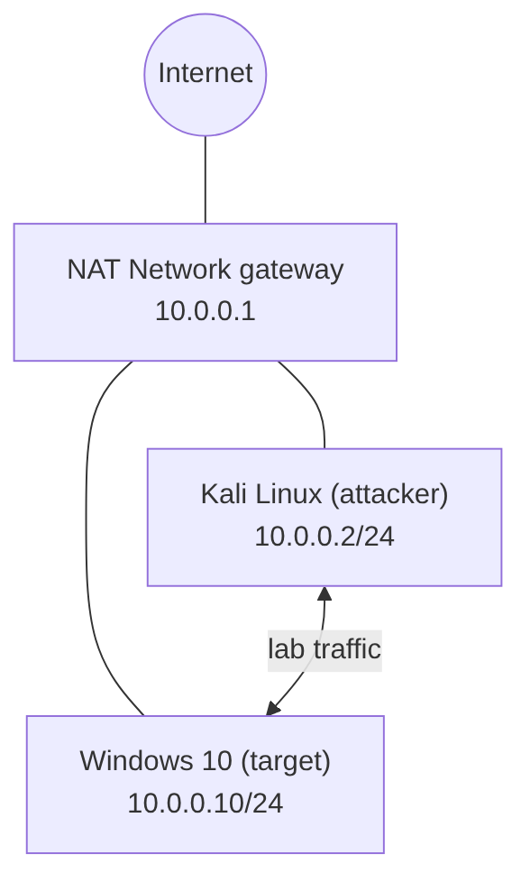
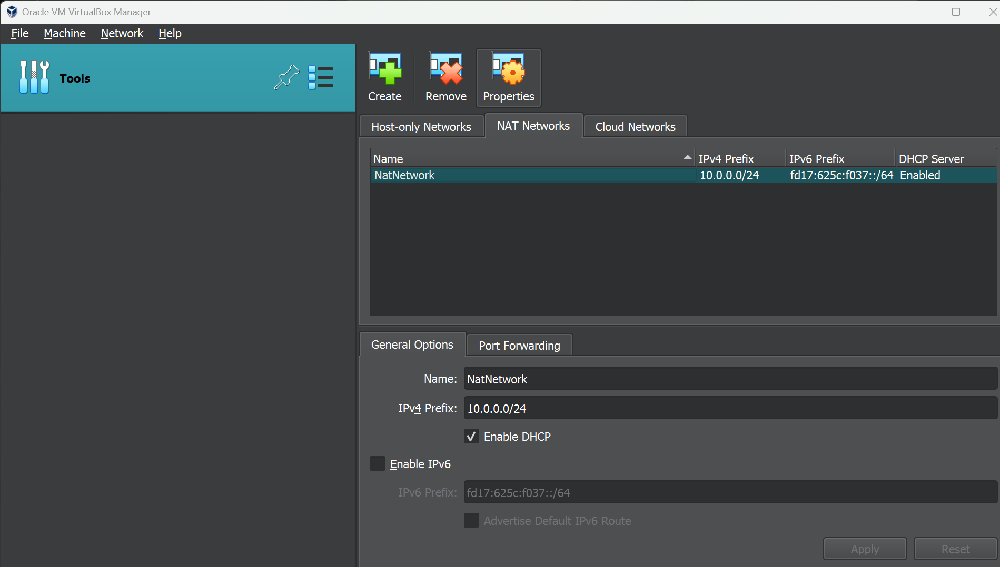
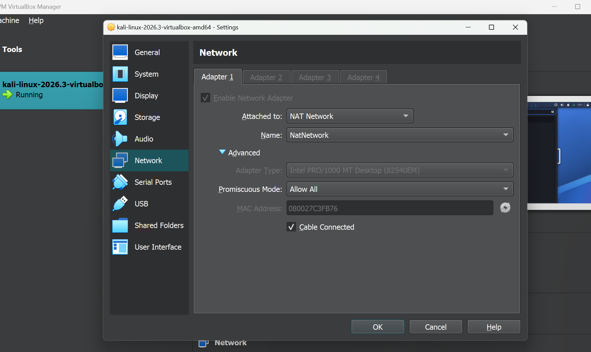
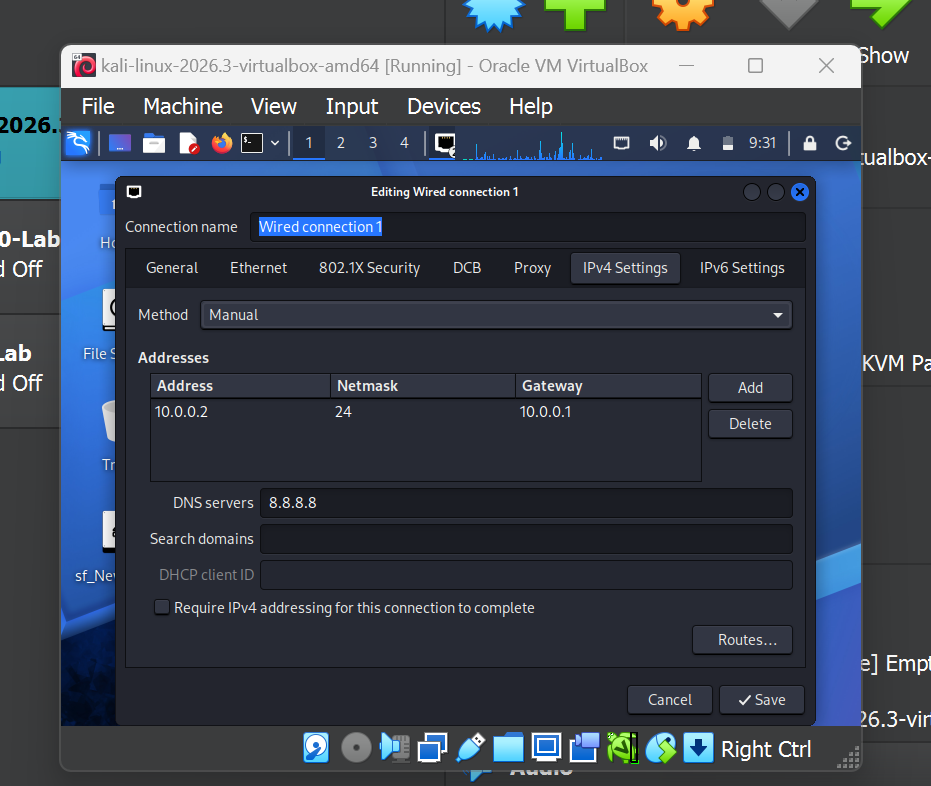
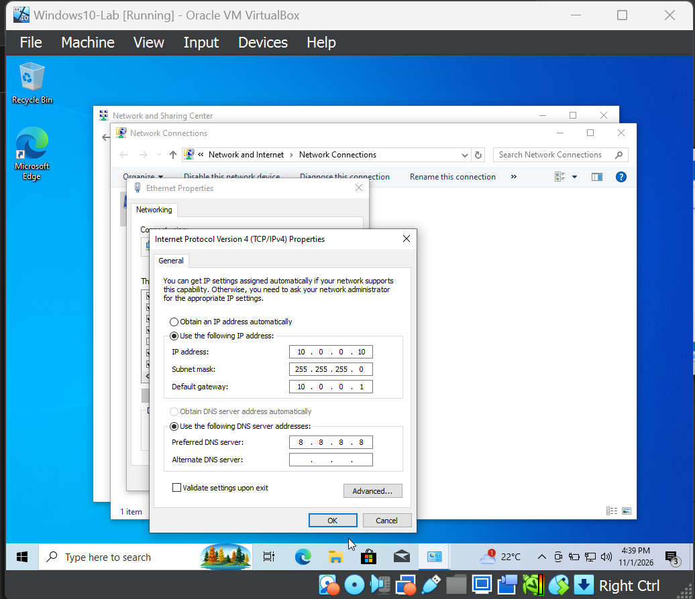
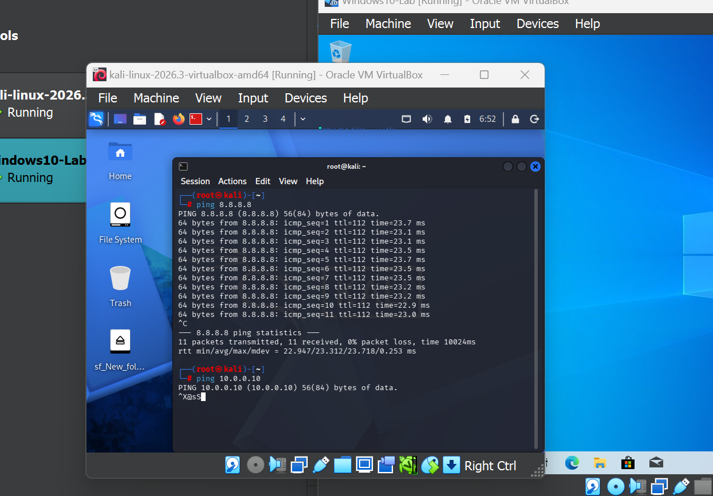
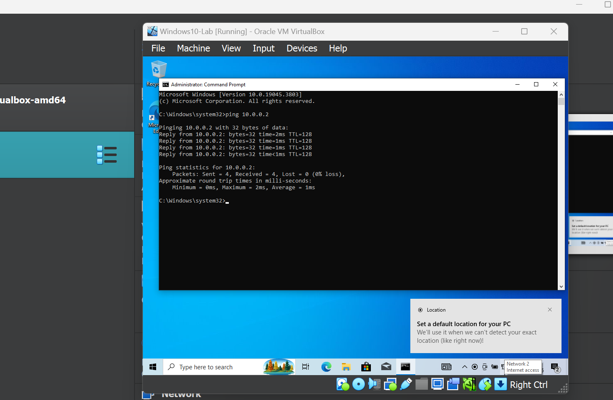

<div align="center">

# 🔐 Cybersecurity Lab Environment Setup

**Building an isolated virtual lab with Kali Linux and a Windows 10 target for penetration testing practice**
</div>

<p align="center">
  
  
  
  
  
  
  
  
  
  
  
</p>

---

## 📌 Project Overview

This project focuses on setting up a **virtual cybersecurity and penetration-testing laboratory** using VirtualBox, Kali Linux and a Windows 10 target machine.

The purpose of the lab is to create a controlled environment where cybersecurity tools, network scanning, reconnaissance, vulnerability assessment, and other security-testing activities can be performed safely and repeatedly.

The lab is configured on a private virtual network so that additional machines can be added later and used as targets for authorized security testing.

---


## 🎯 Objectives

The main objectives of this project are to:

- Install and configure VirtualBox.
- Install/import Kali Linux as a virtual machine.
- Create a Windows 10 virtual machine to act as the target.
- Create a private **NAT Network** for the cybersecurity lab.
- Assign a consistent IP address to each virtual machine.
- Verify network connectivity between the machines and to the Internet.
- Take a clean VM snapshot for recovery.
- Document the complete setup process.
- Prepare the environment for future cybersecurity projects.

---

## 🛡️ Purpose of the Lab

The lab provides an isolated and controlled environment for cybersecurity learning and authorized security testing.

It can be used for activities such as:

- Network reconnaissance
- Port scanning
- Vulnerability assessment
- Packet analysis
- Web security testing
- Exploitation practice
- Security-tool experimentation

⚠️ **Important:** This laboratory must only be used for systems that you own or have explicit permission to test. Do not use the lab or its tools to attack unauthorized systems.

---

## 🏗️ Lab Architecture




Additional target machines can be added to the same virtual network in future projects.

---

## ⚙️ Lab Configuration

| 🧩 Component        | ⚙️ Configuration         |
| ------------------- | ------------------------ |
| 🖥️ Host OS          | [Host operating system]  |
| 🧠 Host RAM         | [Host RAM]               |
| ⚡ Processor        | [Host processor]         |
| 🧰 Hypervisor       | VirtualBox               |
| 🐉 Security OS      | Kali Linux 2026.3        |
| 🪟 Target OS        | Windows 10 (Windows10-Lab) |
| 🌐 Virtual Network  | NAT Network (NatNetwork) |
| 📡 Network Address  | 10.0.0.0/24              |
| 🐧 Kali IP Address  | 10.0.0.2/24              |
| 🪟 Windows IP Address | 10.0.0.10/24           |
| 🚪 Default Gateway  | 10.0.0.1                 |
| 🌍 DNS Server       | 8.8.8.8                  |

---

# 🪜 Lab Setup Procedure

## Step 1. Install VirtualBox

VirtualBox was installed as the hypervisor.

**Tool:** Oracle VM VirtualBox

---

## Step 2. Create the NAT Network

A dedicated NAT Network was created in VirtualBox.

Configuration:
Network Name: NatNetwork
IPv4 Prefix:  10.0.0.0/24
DHCP:         Enabled
IPv6:         Disabled



A **NAT Network** was selected because multiple virtual machines connected to the same NAT Network can communicate with one another while also having outbound network connectivity.

This will allow future attacker and target VMs to communicate within the lab.


---

## Step 3. Import Kali Linux

The Kali Linux virtual machine was downloaded from the official Kali Linux website and imported into VirtualBox.

The VM network adapter was configured as follows:

```text
Adapter 1
Attached to: NAT Network
Network:     NatNetwork
Adapter Type: Intel PRO/1000 MT Desktop
Promiscuous Mode: Allow All
```



---

## Step 4. Configure the Kali Linux Network

The Kali Linux network connection ("Wired connection 1") was changed from automatic to **Manual** and configured with a consistent IPv4 address.

Configuration:

```text
IP Address: 10.0.0.2
Subnet Mask: 255.255.255.0 (/24)
Gateway: 10.0.0.1
DNS: 8.8.8.8
```

A consistent IP address makes it easier to document the lab and reference the Kali machine in future exercises.



---

## Step 5. Configure the Windows 10 Target

A Windows 10 virtual machine (**Windows10-Lab**) was attached to the same NAT Network and given a static IPv4 address from the Network Connections settings.

Configuration:

```text
IP Address: 10.0.0.10
Subnet Mask: 255.255.255.0
Default Gateway: 10.0.0.1
Preferred DNS: 8.8.8.8
```



---

## Step 6. Test Connectivity Between the Machines

From Kali, Internet connectivity was tested with `ping 8.8.8.8` and the Windows target with `ping 10.0.0.10`.



From the Windows machine, the Kali machine was tested with `ping 10.0.0.2`.



The Windows-to-Kali test succeeded with 0% loss, which proves that both machines are on the same virtual network.

---

## Step 7. Create a Clean VM Snapshot

After completing the initial configuration, a VirtualBox snapshot should be created for each VM.

Example snapshot name:

```text
Clean Kali - Network Setup
```

The snapshot represents the clean baseline of the laboratory.

If a future exercise changes or damages the VM configuration, the machine can be restored to this baseline.


---

# 🔎 Lab Verification

| ✅ Test                        | 🧾 Command                      | 🎯 Expected Result              |
| ----------------------------- | ------------------------------- | ------------------------------- |
| 🌐 Check IP address           | `ip a` (Kali) / `ipconfig` (Windows) | Correct IP displayed       |
| 🌍 Test Internet connectivity | `ping 8.8.8.8`                  | Successful replies              |
| 🪟 Kali to Windows            | `ping 10.0.0.10`                | Successful replies (see Problem 1) |
| 🐉 Windows to Kali            | `ping 10.0.0.2`                 | Successful replies              |
| 🔄 Verify snapshot            | Restore snapshot and run `ip a` | Baseline configuration restored |

### Example Results

```text
Kali IP Address:     10.0.0.2/24
Windows IP Address:  10.0.0.10/24
Gateway:             10.0.0.1
DNS:                 8.8.8.8

ping 8.8.8.8 (from Kali):     11 sent, 11 received, 0% loss
ping 10.0.0.2 (from Windows): 4 sent, 4 received, 0% loss
```

---

# 🐞 Problems Encountered & Solutions

Documenting problems is an important part of the project.

## Problem 1. Kali Cannot Ping the Windows Machine

`ping 10.0.0.10` from Kali received no replies, while the Windows machine could ping Kali successfully.

By default, Windows Firewall blocks incoming ICMP echo requests, so the Windows machine does not answer pings even though the network is working.

A possible fix is to enable the inbound echo rule on the Windows machine from an Administrator Command Prompt:

```bat
netsh advfirewall firewall add rule name="Allow ICMPv4 Ping" protocol=icmpv4:8,any dir=in action=allow
```

> **Important:** Only change firewall rules inside the isolated lab, and re-test with `ping 10.0.0.10` from Kali afterwards.

---

## Problem 2. VirtualBox VT-x / Virtualization Error

If a VM fails to start because hardware virtualization is disabled in the system firmware/BIOS, it can be resolved by:

1. Restarting the computer.
2. Entering BIOS/UEFI settings.
3. Enabling Intel VT-x / AMD-V hardware virtualization.
4. Saving the configuration.
5. Restarting the computer.
6. Starting the VM again.


---

# 💡 What I Learned

Through this project, I learned how to create and configure a virtual environment for cybersecurity practice.

The most important concepts I learned include:

### 1. NAT vs NAT Network

A standard NAT configuration and a NAT Network serve different purposes.

A NAT Network allows multiple VMs connected to the same virtual network to communicate with one another while providing network address translation for external connectivity.

This makes it useful for building a multi-machine cybersecurity laboratory.

### 2. Virtual Machine Networking

I learned how VirtualBox virtual network adapters connect virtual machines to different types of networks and how network configuration affects communication between machines.

### 3. Static IP Configuration

I learned how to configure and verify IPv4 addressing, subnet masks, gateways, and DNS settings in both Kali Linux and Windows 10.

### 4. Firewalls and Connectivity Tests

A failed ping does not always mean a network problem. A host firewall can silently block ICMP while the network itself works.

### 5. VM Snapshots

I learned that a clean snapshot should be created **before performing risky or experimental activities**.

This provides a known-good recovery point for future cybersecurity exercises.

### 6. Documentation

I learned that documenting commands, configuration, screenshots, problems, and solutions is an important part of a professional cybersecurity project.

---

# 🔐 Security & Ethical Use

This laboratory is intended strictly for education purposes only.

---

# 🔗 Tools & Resources

- **VirtualBox:** [https://virtualbox.org/wiki/Downloads](https://virtualbox.org/wiki/Downloads)
- **Kali Linux:** [https://kali.org/get-kali](https://kali.org/get-kali)
- **Windows 10:** [https://microsoft.com/software-download/windows10](https://microsoft.com/software-download/windows10)

---

# 👤 Author

**Mugabo Elvis**\
Student ID 28047


---

## 📌 Project Information

**Program Name:** Lab Setup | **Week:** week 1 | **Project:** Cybersecurity & Pentesting Lab Setup | **Repository:** GitHub
